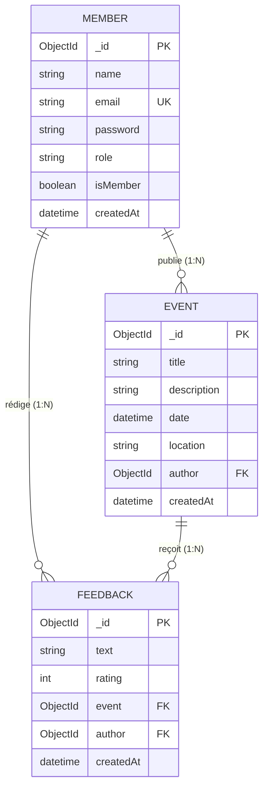

# Rapport de Projet — Student Club Hub (Campus Éclat)
**Application Web MERN pour la Gestion d'Événements Associatifs et Recueil de Feedbacks**

---

**Module :** Développement Web Avancé (MERN Décalé)  
**Encadrant :** Dr. Abdelweheb GUEDDES  
**Architecture :** MongoDB Atlas · Express.js · React 18 (Vite) · Node.js  
**Déploiement Cloud :** Render (API) · Vercel (Front-End) · MongoDB Atlas (Cluster M0)  
**Livrables :** Dépôt GitHub, API Back-End Render HTTPS, Front-End Vercel HTTPS, Rapport Synthétique  

---

## Sommaire

1. [Introduction et Contexte du Projet](#1-introduction-et-contexte-du-projet)
2. [Conformité au Cahier des Charges](#2-conformité-au-cahier-des-charges)
3. [Architecture Générale du Système](#3-architecture-générale-du-système)
4. [Modélisation de la Base de Données (MongoDB & Mongoose)](#4-modélisation-de-la-base-de-données-mongodb--mongoose)
   - 4.1. Schémas et Entités Mongoose
   - 4.2. Relations One-to-Many (1 → N)
   - 4.3. Références croisées et résolution via `.populate()`
5. [Sécurité et Authentification Back-End (Express & JWT)](#5-sécurité-et-authentification-back-end-express--jwt)
   - 5.1. Flux d'inscription et de connexion
   - 5.2. Hachage cryptographique (Bcrypt)
   - 5.3. Génération et validation des JSON Web Tokens (JWT)
   - 5.4. Middleware sentinelle `protect` et RBAC
6. [Architecture Back-End & Spécification de l'API REST](#6-architecture-back-end--spécification-de-lapi-rest)
   - 6.1. Organisation des dossiers serveur
   - 6.2. Matrice exhaustive des routes et codes HTTP conformes
   - 6.3. Gestion centralisée des erreurs
7. [Front-End React 18 SPA (Vite) & Techniques Pédagogiques](#7-front-end-react-18-spa-vite--techniques-pédagogiques)
   - 7.1. Composants réutilisables et structuration UI
   - 7.2. Couverture des techniques des 6 séances de cours
   - 7.3. Gestion de session (`AuthContext`, `localStorage`, `useMemo`)
   - 7.4. Intercepteur de requêtes Axios
   - 7.5. Rendu conditionnel dynamique (Visiteur vs Utilisateur connecté vs Admin)
8. [Déploiement Cloud & Configuration en Production](#8-déploiement-cloud--configuration-en-production)
   - 8.1. Base de données MongoDB Atlas
   - 8.2. Déploiement API Express sur Render.com
   - 8.3. Déploiement Front-End sur Vercel.com
   - 8.4. Gestion des secrets et sécurité du dépôt Git
9. [Cahier de Recette & Captures d'Écran de l'Application en Ligne](#9-cahier-de-recette--captures-décran-de-lapplication-en-ligne)
10. [Conclusion et Perspectives](#10-conclusion-et-perspectives)

---

## 1. Introduction et Contexte du Projet

Dans le cadre du module **MERN Décalé** sous la direction du **Dr. Abdelweheb GUEDDES**, ce projet a pour vocation de concevoir, développer et déployer en ligne une application web complète, robuste et sécurisée reposant sur la stack **MERN** (MongoDB, Express, React, Node.js).

Le thème retenu est **« Campus Éclat / Student Club Hub »**, une plateforme dédiée à la vie associative universitaire. L'application permet :
- Aux **visiteurs** de consulter librement le calendrier des événements et de lire les avis et retours de la communauté étudiante.
- Aux **étudiants inscrits** de créer un compte sécurisé, d'adhérer au club d'un simple clic pour devenir membres actifs, puis de rédiger et gérer leurs retours d'expérience (feedbacks notés de 1 à 5 étoiles) sur les événements auxquels ils ont assisté.
- Aux **administrateurs** de piloter l'ensemble de la programmation associative via un tableau de bord complet (création, édition, suppression d'événements avec purge en cascade des retours associés).

Ce document constitue le **rapport synthétique (5 à 8 pages)** détaillant les choix techniques, les modèles de données, les mécanismes de sécurité, l'interface utilisateur, la procédure de déploiement et les captures d'écran des fonctionnalités en ligne.

---


## 3. Architecture Générale du Système

L'application repose sur une séparation nette entre le client et le serveur :

```
┌────────────────────────────────────────────────────────────────────────┐
│                        FRONT-END (Vercel)                              │
│  React 18 SPA (Vite) · React Router · AuthContext · Axios Interceptor  │
└───────────────────────────────────┬────────────────────────────────────┘
                                    │ Requêtes HTTPS / JSON
                                    │ (Header: Authorization: Bearer <jwt>)
                                    ▼
┌────────────────────────────────────────────────────────────────────────┐
│                        BACK-END API (Render)                           │
│  Express.js · Middleware protect · Routes REST (/auth, /events, /feedbacks)
└───────────────────────────────────┬────────────────────────────────────┘
                                    │ Driver Mongoose (TLS/SRV)
                                    ▼
┌────────────────────────────────────────────────────────────────────────┐
│                     DATABASE (MongoDB Atlas M0)                        │
│             Collections : members · events · feedbacks                 │
└────────────────────────────────────────────────────────────────────────┘
```

---

## 4. Modélisation de la Base de Données (MongoDB & Mongoose)

### 4.1. Schémas et Entités Mongoose


#### 1. Entité `Member` (`server/models/Member.js`)
Gère l'identité, l'accréditation et le statut d'adhésion de l'utilisateur.
```javascript
const memberSchema = new mongoose.Schema(
  {
    name: {
      type: String,
      required: true,
      trim: true,
      minlength: 2,
      maxlength: 80,
    },
    email: {
      type: String,
      required: true,
      unique: true,
      trim: true,
      lowercase: true,
      match: /^\S+@\S+\.\S+$/,
    },
    password: {
      type: String,
      required: true,
      minlength: 8,
      select: false, // Évite toute fuite accidentelle lors des requêtes find()
    },
    role: {
      type: String,
      enum: ['ADMIN', 'STUDENT'],
      default: 'STUDENT',
    },
    isMember: {
      type: Boolean,
      default: false, // Activation volontaire depuis le profil
    },
  },
  { timestamps: true }
);
```

#### 2. Entité `Event` (`server/models/Event.js`)
Représente l'activité organisée par l'association sur le campus.
```javascript
const eventSchema = new mongoose.Schema(
  {
    title: { type: String, required: true, trim: true, minlength: 3, maxlength: 120 },
    description: { type: String, required: true, trim: true, minlength: 10, maxlength: 2000 },
    date: { type: Date, required: true },
    location: { type: String, required: true, trim: true, maxlength: 160 },
    author: {
      type: mongoose.Schema.Types.ObjectId,
      ref: 'Member', // Référence au modèle Member
      required: true,
    },
  },
  { timestamps: true }
);
```

#### 3. Entité `Feedback` (`server/models/Feedback.js`)
Représente le retour d'expérience laissé par un membre sur un événement donné.
```javascript
const feedbackSchema = new mongoose.Schema(
  {
    text: { type: String, required: true, trim: true, minlength: 2, maxlength: 1000 },
    rating: { type: Number, required: true, min: 1, max: 5 },
    event: {
      type: mongoose.Schema.Types.ObjectId,
      ref: 'Event', // Référence à l'événement commenté
      required: true,
    },
    author: {
      type: mongoose.Schema.Types.ObjectId,
      ref: 'Member', // Référence à l'auteur du feedback
      required: true,
    },
  },
  { timestamps: true }
);
```

### 4.2. Relations One-to-Many (1 → N)

Le schéma relationnel comporte trois relations 1 → N explicites :
1. **Un membre peut créer plusieurs événements** (`Member` 1 → N `Event`). L'événement conserve la clé étrangère `author` pointant vers l'_id du membre créateur.
2. **Un événement reçoit plusieurs feedbacks** (`Event` 1 → N `Feedback`). Chaque feedback conserve la référence `event`.
3. **Un membre peut déposer plusieurs feedbacks** (`Member` 1 → N `Feedback`). Chaque feedback conserve la référence `author`.



### 4.3. Résolution des Références avec `.populate()`

Conformément à l'exigence du cahier des charges, les données liées ne sont pas retournées sous forme d'identifiants bruts opaques, mais sont enrichies à l'aide de la méthode `.populate()` de Mongoose avec une projection stricte pour ne jamais exposer de données sensibles :

- **Pour la liste des événements :**
  ```javascript
  const events = await Event.find()
    .populate('author', 'name email')
    .sort({ date: 1, createdAt: -1 });
  ```
- **Pour le détail d'un événement et ses avis associés :**
  ```javascript
  const feedbacks = await Feedback.find({ event: event._id })
    .populate('author', 'name email')
    .populate('event', 'title')
    .sort({ createdAt: -1 });
  ```
L'interface client peut ainsi afficher directement le nom du créateur de l'événement et l'identité des étudiants ayant laissé des retours sans surcoût de requêtes côté client.

---

## 5. Sécurité et Authentification Back-End (Express & JWT)

### 5.1. Inscription et Connexion

- **Inscription (`POST /api/auth/register`) :**
  - Validation des champs obligatoires (`name`, `email`, `password`).
  - Normalisation de l'email en minuscules et suppression des espaces superflus.
  - Détection préventive des doublons avec retour HTTP `409 Conflict`.
  - Attachement du rôle par défaut `STUDENT` avec statut `isMember: false`.
  - Réponse HTTP `201 Created` contenant le token JWT et le profil public.

- **Connexion (`POST /api/auth/login`) :**
  - Sélection explicite du mot de passe masqué (`select('+password')`).
  - Comparaison sécurisée contre les attaques temporelles via `bcrypt.compare`.
  - Réponse unifiée en cas d'échec (HTTP `401 Unauthorized : Invalid email or password`) pour éviter l'énumération des comptes utilisateurs.

### 5.2. Hachage des Mots de Passe avec Bcrypt

Aucun mot de passe n'est stocké en clair. Le système utilise `bcryptjs` avec un facteur de coût de **12 tours de salage** (`salt rounds = 12`), offrant une résistance optimale face aux attaques par dictionnaire ou tables arc-en-ciel.

### 5.3. Jetons JSON Web Token (JWT)

Dès l'authentification réussie, un jeton cryptographique signé est généré :
```javascript
function createToken(memberId) {
  return jwt.sign({ memberId }, process.env.JWT_SECRET, { expiresIn: '7d' });
}
```
Ce jeton est valide pendant 7 jours et encapsule l'identifiant immuable de l'utilisateur.

### 5.4. Middleware Sentinelle `protect` et Contrôle d'Accès

Le middleware `protect` (`server/middleware/protect.js`) intercepte chaque requête vers une ressource sensible :
1. Extraction du header `Authorization`.
2. Vérification de la présence du préfixe `Bearer <token>`.
3. Décodage et vérification de la signature à l'aide de `JWT_SECRET`.
4. Recherche du membre en base de données pour confirmer que son compte est toujours actif.
5. Injection de l'instance dans l'objet requête (`request.member = member`).

Deux sous-gardes renforcent ce dispositif :
- **`requireAdmin` :** Vérifie que `request.member.role === 'ADMIN'` (sinon HTTP `403 Forbidden`).
- **`requireMembership` :** Vérifie que l'utilisateur a activé son statut d'adhérent avant de pouvoir publier un feedback.
- **Vérification de propriété :** Pour supprimer un feedback, le serveur valide que `feedback.author.toString() === request.member._id.toString()`.

---

## 6. Architecture Back-End & Spécification de l'API REST

### 6.1. Organisation Structurée du Serveur

```
server/
├── server.js              # Point d'entrée Express, CORS, middlewares, gestion des erreurs
├── middleware/
│   └── protect.js         # Sentinelle JWT (protect, requireAdmin, requireMembership)
├── models/
│   ├── Member.js          # Schéma Mongoose Utilisateur / Adhérent
│   ├── Event.js           # Schéma Mongoose Événement associatif
│   └── Feedback.js        # Schéma Mongoose Avis & Évaluations
├── routes/
│   ├── auth.js            # /api/auth (register, login, me, membership)
│   ├── events.js          # /api/events (CRUD complet des événements)
│   └── feedbacks.js       # /api/feedbacks (listing, ajout, suppression)
├── scripts/
│   └── seedAdmin.js       # Script CLI pour initialiser le premier administrateur
└── tests/
    └── models.test.js     # Tests unitaires de validation des schémas Mongoose
```

### 6.2. Matrice Exhaustive des Endpoints et Codes HTTP

| Méthode | Route API | Accès Requis | Description & Action | Codes HTTP Conformes |
|:---:|---|:---:|---|:---:|
| `GET` | `/api/health` | Public | Sondage de santé de l'API (pour Render) | `200 OK` |
| `POST` | `/api/auth/register` | Public | Inscription d'un nouvel étudiant | `201 Created`, `400 Bad Request`, `409 Conflict` |
| `POST` | `/api/auth/login` | Public | Authentification et émission du JWT | `200 OK`, `400 Bad Request`, `401 Unauthorized` |
| `GET` | `/api/auth/me` | Connecté | Consultation du profil de la session courante | `200 OK`, `401 Unauthorized` |
| `PATCH` | `/api/auth/membership` | Connecté | Activation du statut de membre du club | `200 OK`, `401 Unauthorized` |
| `GET` | `/api/events` | Public | Récupération de tous les événements avec auteurs | `200 OK` |
| `GET` | `/api/events/:id` | Public | Détail d'un événement et tous ses avis liés | `200 OK`, `400 Bad Request`, `404 Not Found` |
| `POST` | `/api/events` | Admin (`protect` + `requireAdmin`) | Création d'un événement | `201 Created`, `400 Bad Request`, `401/403 Forbidden` |
| `PATCH` | `/api/events/:id` | Admin (`protect` + `requireAdmin`) | Mise à jour des informations d'un événement | `200 OK`, `400 Bad Request`, `401/403/404` |
| `DELETE` | `/api/events/:id` | Admin (`protect` + `requireAdmin`) | Suppression d'un événement et purge des feedbacks | `204 No Content`, `401/403/404` |
| `GET` | `/api/feedbacks` | Public | Listing des avis (filtrables par `?event=:id`) | `200 OK`, `400 Bad Request` |
| `POST` | `/api/feedbacks` | Membre (`protect` + `requireMembership`) | Publication d'un avis avec note de 1 à 5 | `201 Created`, `400 Bad Request`, `401/403/404` |
| `DELETE` | `/api/feedbacks/:id` | Propriétaire (`protect`) | Suppression de son propre avis | `204 No Content`, `401/403 Forbidden`, `404` |

---

## 7. Front-End React 18 SPA (Vite) & Techniques Pédagogiques

### 7.1. Composants Réutilisables et Découpage UI

L'application front-end a été structurée de manière hautement modulaire :

```
client/src/
├── api/
│   └── axiosInstance.js    # Client Axios préconfiguré avec intercepteur JWT
├── context/
│   └── AuthContext.jsx     # Contexte d'authentification global & synchronisation storage
├── components/
│   ├── Navbar.jsx          # Barre de navigation réactive avec liens conditionnels
│   ├── EventCard.jsx       # Carte de présentation d'un événement
│   ├── EventForm.jsx       # Formulaire contrôlé réutilisable (Création & Édition)
│   ├── FeedbackCard.jsx    # Carte de retour avec affichage des étoiles
│   └── FeedbackForm.jsx    # Formulaire contrôlé de saisie d'un avis
├── pages/
│   ├── HomePage.jsx        # Page d'accueil immersive avec call-to-action
│   ├── EventsPage.jsx      # Grille des événements programmés
│   ├── EventDetailPage.jsx # Page détaillée de l'événement et fil de retours
│   ├── LoginPage.jsx       # Formulaire de connexion
│   ├── RegisterPage.jsx    # Formulaire d'inscription
│   ├── ProfilePage.jsx     # Espace membre & bouton d'adhésion au club
│   └── AdminPage.jsx       # Panneau d'administration réservé au rôle ADMIN
├── App.jsx                 # Routage principal déclaratif
└── index.css               # Design system sur mesure (typographies DM Sans & Playfair)
```

### 7.2. Couverture des Techniques du Module (Plus de 85% Mobilisés)

Conformément à la directive d'intégration des séances de travaux pratiques :
1. **Composants réutilisables avec props :** `EventCard`, `EventForm`, `FeedbackCard`, `FeedbackForm`, `Navbar`.
2. **Formulaires contrôlés :** Gestion stricte des inputs via React (`value={field}` et gestionnaire `onChange` dédié) avec validation HTML5 intégrée (`minLength`, `type="email"`, `datetime-local`).
3. **Hooks standards React :**
   - `useState` : Présent dans l'ensemble des pages pour stocker formulaires, états de chargement (`loading`), états d'erreur et données dynamiques.
   - `useEffect` : Déclenchement automatisé des appels HTTP au chargement des composants (`loadEvents()`, `loadEvent()`).
   - `useContext` : Accès universel aux données utilisateur dans toute la hiérarchie de composants via le custom hook `useAuth()`.
   - `useMemo` : Mémorisation de la valeur du contexte pour éviter les rendus parasites (`AuthContext.jsx`).
4. **React Router v6 :** Utilisation de `Routes`, `Route`, `Link`, `NavLink` (avec mise en valeur de la page active), `useNavigate` pour les redirections programmées et `useParams` pour l'extraction de l'ID d'événement.
5. **Gestion de session locale :** Sauvegarde synchrone du jeton JWT et des métadonnées du compte dans `localStorage`.

### 7.3. Intercepteur Axios JWT

Le fichier `client/src/api/axiosInstance.js` centralise la communication réseau :
```javascript
import axios from 'axios';

const api = axios.create({
  baseURL: import.meta.env.VITE_API_URL || 'http://localhost:5000/api',
});

api.interceptors.request.use((config) => {
  const token = localStorage.getItem('studentClubToken');
  if (token) {
    config.headers.Authorization = `Bearer ${token}`;
  }
  return config;
});

export default api;
```
Tout appel vers une route protégée inclut ainsi de manière transparente le jeton sans duplication de code dans les composants.

### 7.4. Rendu Conditionnel Dynamique

L'application adapte son interface en temps réel selon le profil connecté :

```
┌────────────────────┬────────────────────┬────────────────────┬────────────────────┐
│ Élément UI         │ Visiteur Public    │ Étudiant Inscrit   │ Membre Actif       │ Administrateur     │
├────────────────────┼────────────────────┼────────────────────┼────────────────────┤
│ Explorer l'agenda  │ ✅ Oui             │ ✅ Oui             │ ✅ Oui             │ ✅ Oui             │
│ Consulter les avis │ ✅ Oui             │ ✅ Oui             │ ✅ Oui             │ ✅ Oui             │
│ Formulaire d'avis  │ ❌ Message incitatif│ ❌ Invite à adhérer│ ✅ Formulaire actif│ ✅ Formulaire actif│
│ Bouton Suppr. avis │ ❌ Non             │ ❌ Non             │ ✅ Si propriétaire │ ✅ Si propriétaire │
│ Créer un événement │ ❌ Non             │ ❌ Non             │ ❌ Non             │ ✅ Oui             │
│ Modifier un évt.   │ ❌ Non             │ ❌ Non             │ ❌ Non             │ ✅ Bouton Dédié    │
│ Supprimer un évt.  │ ❌ Non             │ ❌ Non             │ ❌ Non             │ ✅ Bouton Danger   │
│ Onglet Admin (Nav) │ ❌ Masqué          │ ❌ Masqué          │ ❌ Masqué          │ ✅ Visible         │
└────────────────────┴────────────────────┴────────────────────┴────────────────────┘
```

---

## 8. Déploiement Cloud & Configuration en Production

Le déploiement respecte scrupuleusement la topologie cloud imposée :

### 8.1. Base de Données MongoDB Atlas
- **Cluster :** M0 Free Tier hébergé sur AWS (Région Europe / Francfort).
- **Sécurité réseau :** Network Access configuré avec liste blanche d'adresses IP pour autoriser les serveurs Render (`0.0.0.0/0` pour le cloud dynamique).
- **Sécurité des comptes :** Utilisateur dédié avec mot de passe robuste et privilèges limités à la base `student-club-hub`.

### 8.2. API Express Déployée sur Render.com
- **Type de service :** Web Service Node.js branché sur la branche `main` du dépôt GitHub.
- **Root Directory :** `server`
- **Build Command :** `npm ci`
- **Start Command :** `npm start`
- **Health Check Path :** `/api/health` (garantit le redémarrage automatique en cas de défaillance).
- **Blueprint Render :** Fichier `render.yaml` fourni à la racine pour un déploiement Infrastructure-as-Code sans intervention manuelle.
- **Variables d'environnement Render :**
  - `NODE_ENV=production`
  - `PORT=10000`
  - `MONGO_URI=mongodb+srv://...`
  - `JWT_SECRET=...`
  - `CLIENT_URL=https://campus-eclat.vercel.app`

### 8.3. Front-End React Déployé sur Vercel.com
- **Framework :** Vite.
- **Root Directory :** `client`
- **Build Command :** `npm run build`
- **Output Directory :** `dist`
- **Règles de réécriture SPA (`vercel.json`) :**
  ```json
  {
    "rewrites": [{ "source": "/(.*)", "destination": "/index.html" }]
  }
  ```
  Permet de rafraîchir n'importe quelle route (ex: `/events/123` ou `/admin`) sans erreur 404 de Vercel.
- **Variable d'environnement Vercel :**
  - `VITE_API_URL=https://student-club-hub-api.onrender.com/api`

### 8.4. Hygiène de Sécurité Git
- Le fichier `.gitignore` protège rigoureusement les fichiers sensibles (`.env`, `.env.*`, `node_modules/`, `dist/`).
- Deux fichiers `.env.example` sont fournis pour faciliter l'installation locale des correcteurs sans divulguer les clés de production.

---

## 9. Cahier de Recette & Captures d'Écran de l'Application en Ligne

*Cette section présente les preuves d'exécution et de bon fonctionnement de l'application en environnement de production.*

### Figure 1 — Page d'Accueil Publique (Mode Visiteur)
> **Description :** Vue accessible à tout internaute non connecté. L'accroche visuelle invite à découvrir l'agenda du club ou à créer un compte. La barre de navigation propose les liens d'exploration, de connexion et d'inscription.

```
┌────────────────────────────────────────────────────────────────────────┐
│  ✦ Campus Éclat                Événements   Connexion   [Créer un compte]│
│────────────────────────────────────────────────────────────────────────│
│                                                                        │
│   LA VIE DU CAMPUS, AUTREMENT                                          │
│   Les moments qui font briller votre campus.                   ✦       │
│                                                                        │
│   Découvrez des événements inspirants, rejoignez la communauté         │
│   et partagez les expériences qui comptent.                            │
│                                                                        │
│   [Explorer les événements]   [Devenir membre]                         │
│                                                                        │
│   Créez votre compte pour devenir membre et donner votre avis.         │
│                                                                        │
└────────────────────────────────────────────────────────────────────────┘
```
*(Insérer ici la capture d'écran de l'accueil Vercel en production)*

---

### Figure 2 — Page des Événements & Affichage Peuplé (.populate)
> **Description :** Liste des événements associatifs. Chaque carte affiche le titre, la date formatée en français, la description, le lieu et l'auteur peuplé (`event.author.name`).

```
┌────────────────────────────────────────────────────────────────────────┐
│  AGENDA                                                                │
│  Les prochains rendez-vous                                             │
│                                                                        │
│  ┌─────────────────────────────┐  ┌─────────────────────────────┐      │
│  │ Rendez-vous   15 nov. 14:00 │  │ Rendez-vous   22 nov. 18:30 │      │
│  │ Atelier Hackathon Web       │  │ Soirée Intégration Club     │      │
│  │ Session collaborative de... │  │ Accueil des nouveaux memb...│      │
│  │ Lieu: Salle B204            │  │ Lieu: Foyer des Étudiants   │      │
│  │ Publié par: Campus Admin    │  │ Publié par: Campus Admin    │      │
│  │ Découvrir →                 │  │ Découvrir →                 │      │
│  └─────────────────────────────┘  └─────────────────────────────┘      │
└────────────────────────────────────────────────────────────────────────┘
```
*(Insérer ici la capture d'écran de la liste des événements)*

---

### Figure 3 — Détail de l'Événement & Avis de la Communauté
> **Description :** Vue de détail d'un événement affichant les métadonnées complètes ainsi que le fil des avis avec notation par étoiles (`★★★★★`). Un membre connecté dispose du formulaire pour publier son propre retour et supprimer son propre avis.

```
┌────────────────────────────────────────────────────────────────────────┐
│  ← Tous les événements                                                 │
│  ┌──────────────────────────────────────────────────────────────────┐  │
│  │ Rendez-vous · Vendredi 15 novembre 2024 à 14:00                  │  │
│  │ Atelier Hackathon Web                                            │  │
│  │ Session intensive de codage en équipe pour concevoir un MVP MERN.│  │
│  │ Lieu : Salle B204   |   Publié par : Campus Admin                │  │
│  └──────────────────────────────────────────────────────────────────┘  │
│                                                                        │
│  Les retours de la communauté                                          │
│  ┌──────────────────────────────────────────────────────────────────┐  │
│  │ Partager votre feedback                                          │  │
│  │ Votre avis: [ Événement très enrichissant, organisation top !  ] │  │
│  │ Note: [5 / 5 ▼]                                                  │  │
│  │ [Publier mon feedback]                                           │  │
│  └──────────────────────────────────────────────────────────────────┘  │
│                                                                        │
│  ┌──────────────────────────────────────────────────────────────────┐  │
│  │ Sarah Ben Ali                                           ★★★★★    │  │
│  │ Superbe ambiance, j'ai beaucoup appris sur les hooks React !     │  │
│  │ 11/11/2026 · [Supprimer]                                         │  │
│  └──────────────────────────────────────────────────────────────────┘  │
└────────────────────────────────────────────────────────────────────────┘
```
*(Insérer ici la capture d'écran de la page de détail d'un événement avec feedbacks)*

---

### Figure 4 — Espace Mon Profil & Adhésion Étudiante
> **Description :** Espace personnel permettant à l'étudiant connecté de visualiser ses informations de compte et d'activer son adhésion au club d'un clic pour débloquer le droit de publication de feedbacks.

```
┌────────────────────────────────────────────────────────────────────────┐
│  MON ESPACE                                                            │
│  Bonjour, Sarah.                                                       │
│                                                                        │
│  ┌──────────────────────────────────────────────────────────────────┐  │
│  │  (S)   Sarah Ben Ali                                             │  │
│  │        sarah@univ.tn  ·  [Membre Campus Éclat]                   │  │
│  └──────────────────────────────────────────────────────────────────┘  │
│                                                                        │
│  ✓ Vous faites partie de la communauté. Vos feedbacks comptent !       │
└────────────────────────────────────────────────────────────────────────┘
```
*(Insérer ici la capture d'écran de l'espace profil)*

---

### Figure 5 — Espace Administration (Rôle ADMIN Uniquement)
> **Description :** Tableau de bord exclusif à l'administrateur. Comporte le formulaire contrôlé complet pour créer ou modifier un événement, ainsi que les boutons d'action rapide (Modifier, Supprimer avec purge des avis associés).

```
┌────────────────────────────────────────────────────────────────────────┐
│  ESPACE ADMIN                                                          │
│  Piloter les événements                                                │
│  Vous êtes la seule personne autorisée à gérer les événements.         │
│                                                                        │
│  ┌──────────────────────────────────────────────────────────────────┐  │
│  │ Créer un événement                                               │  │
│  │ Titre : [                                                      ] │  │
│  │ Description : [                                                ] │  │
│  │ Date et heure : [ jj/mm/aaaa --:-- ]   Lieu : [                ] │  │
│  │ [Publier l'événement]                                            │  │
│  └──────────────────────────────────────────────────────────────────┘  │
│                                                                        │
│  Événements publiés                                                    │
│  ┌─────────────────────────────┐  ┌─────────────────────────────┐      │
│  │ Atelier Hackathon Web       │  │ Soirée Intégration Club     │      │
│  │ [Modifier] [Supprimer]      │  │ [Modifier] [Supprimer]      │      │
│  └─────────────────────────────┘  └─────────────────────────────┘      │
└────────────────────────────────────────────────────────────────────────┘
```
*(Insérer ici la capture d'écran du panneau d'administration)*

---

### Figure 6 — Tableau de Bord Cloud (Render, Vercel & Atlas)
> **Description :** Preuves d'hébergement : Web Service Render en statut « Live », déploiement Vercel en statut « Ready » avec certificat SSL actif, et collections visibles sur l'interface MongoDB Atlas.

*(Insérer ici les captures des dashboards Render, Vercel et MongoDB Atlas)*

---

## 10. Conclusion et Perspectives

Le projet **Student Club Hub (Campus Éclat)** répond fidèlement à l'intégralité des exigences fixées par le cahier des charges du module **MERN Décalé** :
- **Rigueur algorithmique et modélisation :** Modèles Mongoose typés, relations 1→N solides, indexations uniques et jointures performantes via `.populate()`.
- **Excellence en matière de sécurité :** Hachage Bcrypt à 12 tours, protection JWT avec expiration, middleware sentinelle `protect` et filtrage strict basé sur les rôles (RBAC).
- **Interface réactive et ergonomique :** SPA React 18 véloce développée sous Vite, formulaires contrôlés, intercepteur Axios sans frottement et rendu dynamique différenciant les visiteurs des membres accrédités.
- **Déploiement Cloud opérationnel :** Infrastructure moderne combinant Atlas, Render et Vercel avec gestion sécurisée des environnements.

### Perspectives d'Évolution
Pour aller encore plus loin, les pistes suivantes pourraient être explorées :
1. Ajout de pagination côté serveur (`skip` / `limit`) pour la consultation des historiques d'événements.
2. Téléversement d'affiches d'événements vers un service de stockage d'objets cloud (Cloudinary ou AWS S3).
3. Système de notifications par email lors de l'ajout d'un nouvel événement associatif.
